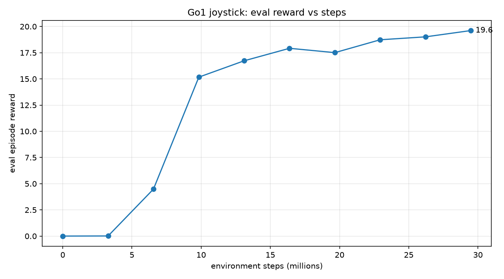
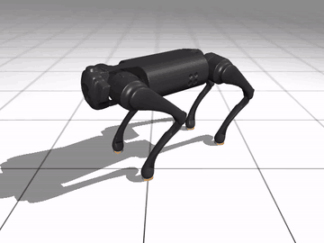
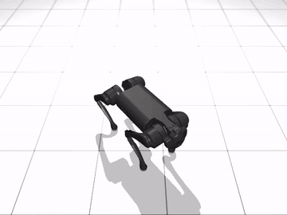
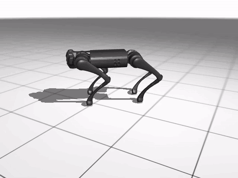

# HaiDuong

### Latest test: [Test 6](Tests/Test6/Test6.md)
**Control run, about 29.5M steps: the Go1 stays upright but doesn't walk.**

 eval reward vs steps &nbsp;·&nbsp; 19.6 at 29.5M steps

<table align="center">
  <tr>
    <td align="center">
      
       side view
    </td>
    <td align="center">
      
       top view
    </td>
  </tr>
  <tr>
    <td colspan="2" align="center">
      
       track view &nbsp;·&nbsp; command x = 1, y = 0, yaw = 0 &nbsp;·&nbsp; mean speed tracking 0.019 (standing still)
    </td>
  </tr>
</table>

<!-- Keep the fun fact as the last section of this README. New sections go above it. -->

> **Fun fact:** HaiDuong (Hải Dương) is my hometown in Vietnam. I have named the repo after it
> because it was windy this day and it reminds me of the autumn there.
