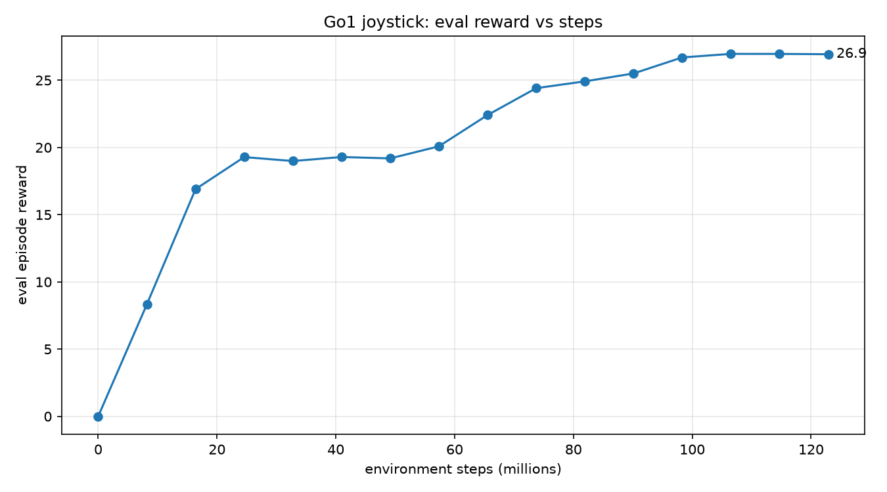
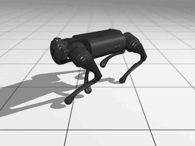
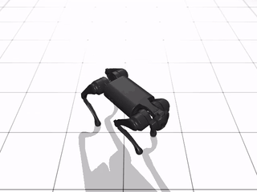
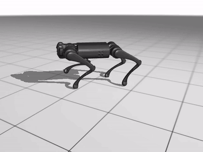
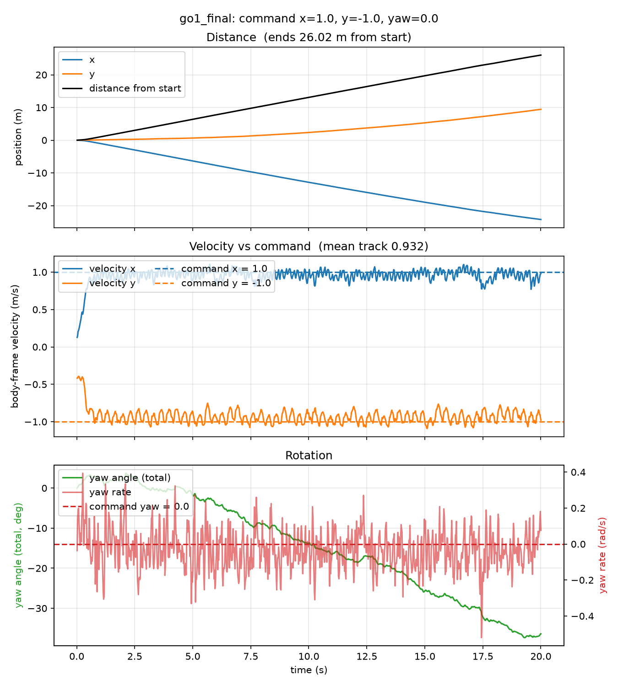

# HaiDuong

### Latest test: [Test 7](Tests/Test7/Test7.md)
**Diagonal commands, about 123M steps: the Go1 walks forward and sideways at the same time, even outside the trained range.**

 eval reward vs steps &nbsp;·&nbsp; 26.9 at 122.9M steps

<table align="center">
  <tr>
    <td align="center">
      
       side view
    </td>
    <td align="center">
      
       top view
    </td>
  </tr>
  <tr>
    <td colspan="2" align="center">
      
       track view &nbsp;·&nbsp; command x = 1, y = -1, yaw = 0 &nbsp;·&nbsp; mean speed tracking 0.932 (walking)
    </td>
  </tr>
</table>

 distance, velocity vs command and rotation &nbsp;·&nbsp; command x = 1, y = -1, yaw = 0

<!-- Keep the fun fact as the last section of this README. New sections go above it. -->

> **Fun fact:** HaiDuong (Hải Dương) is my hometown in Vietnam. I have named the repo after it
> because it was windy this day and it reminds me of the autumn there.
