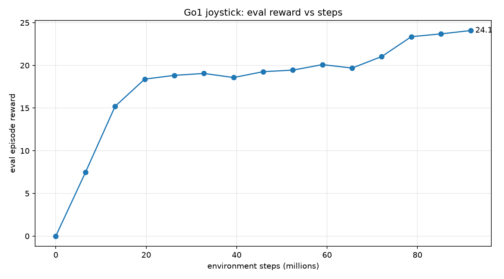
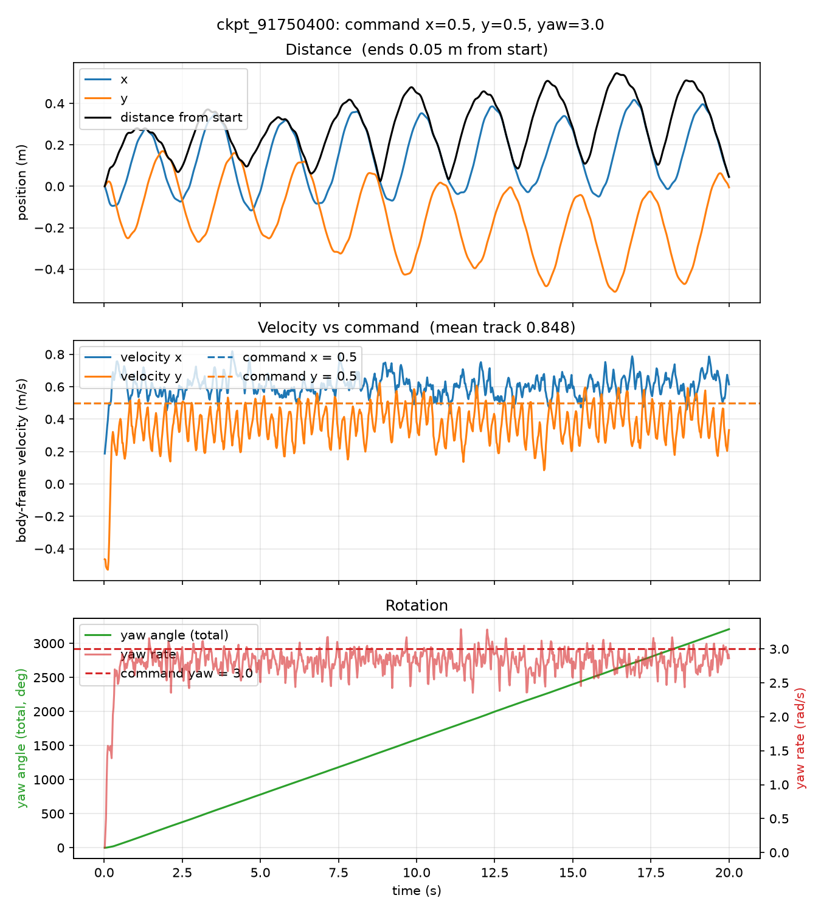
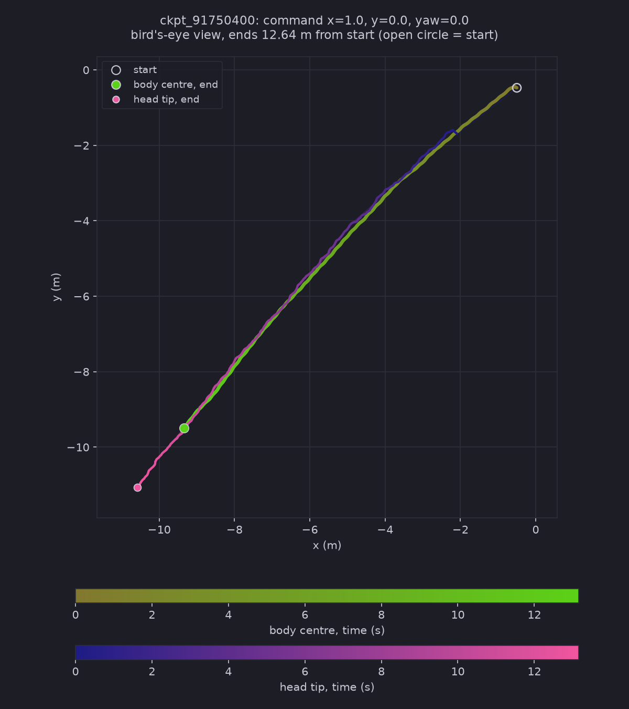
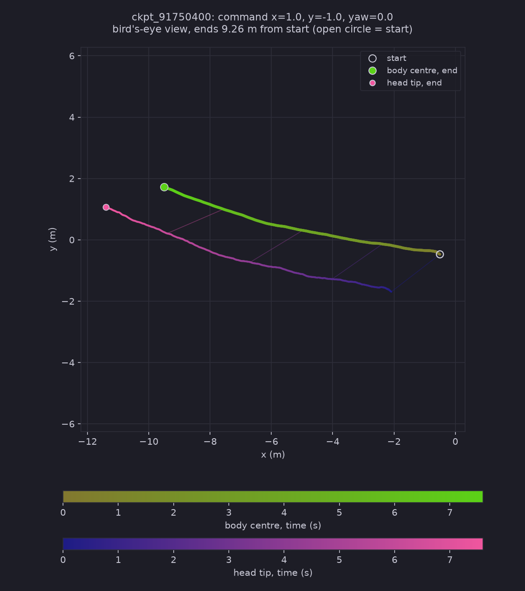
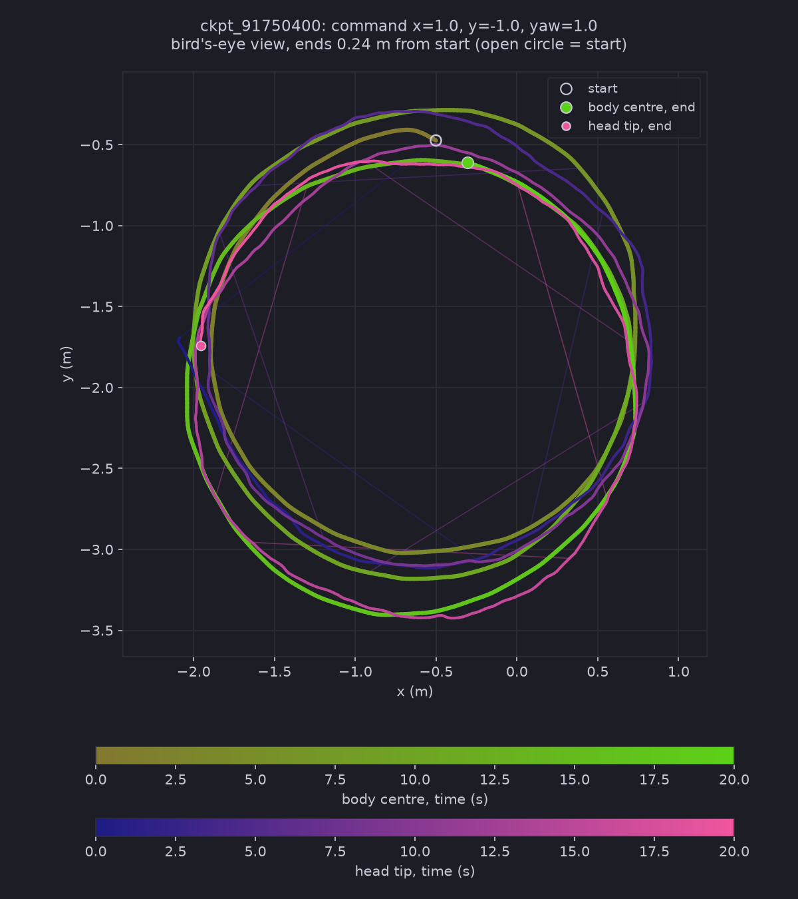
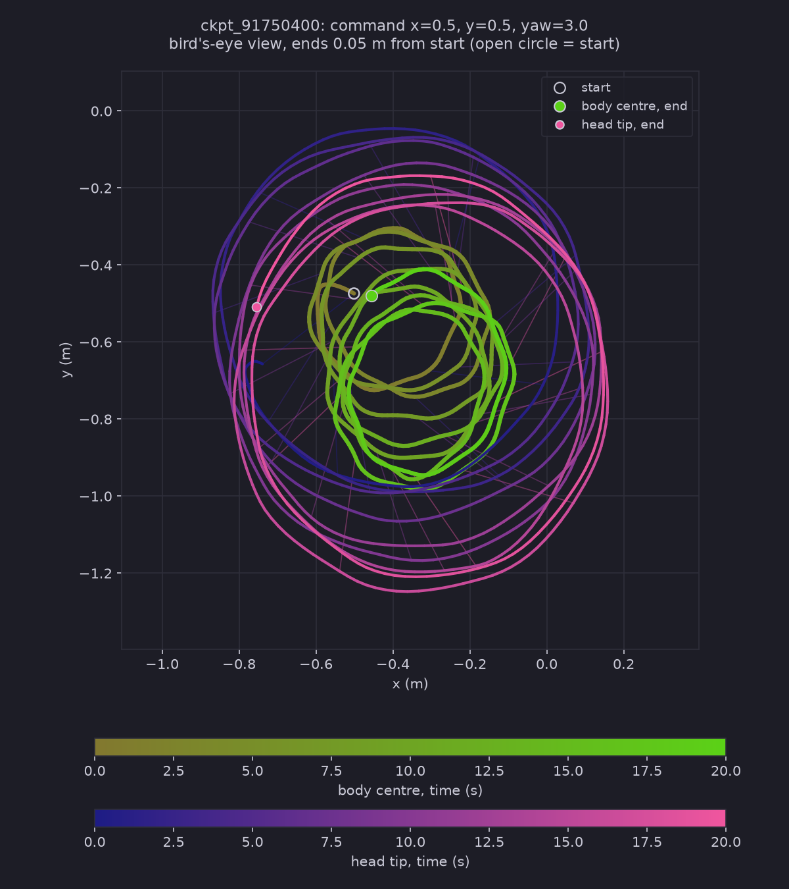

# Test Log 8 — Rough terrain (about 91.75M steps, run stopped early, local RTX 5060)

**Date:** 2026-10-21
**Result:** Pass with caveats. A policy trained on rough terrain follows straight, diagonal, circling and fast-spin commands (`track` 0.82 to 0.93). The run stopped at 91.75M of the planned 111.4M steps because the GPU ran out of memory.

**Purpose:** The first test on a different terrain. Train the Go1 on `Go1JoystickRoughTerrain` at about 110M steps, then check whether it follows four commands: straight (1 / 0 / 0), a diagonal outside the trained range (1 / -1 / 0), the diagonal while turning (1 / -1 / 1) and a slow diagonal with a fast spin (0.5 / 0.5 / 3).

## Setup

| Setting | Value |
|---|---|
| Task | `Go1JoystickRoughTerrain` (default config, domain randomization on) |
| `ppo_params.num_timesteps` | 110,000,000 |
| `ppo_params.num_evals` | 18 |
| Planned steps | 111,411,200 (17 epochs of 6,553,600) |
| **Steps actually run** | **91,750,400** (14 epochs). The run crashed before the last 3. |
| `num_envs` | 4096 |
| Hardware | NVIDIA GeForce RTX 5060 Laptop (8 GB), WSL2 Ubuntu 24.04 |
| Run | `train_test.py` (copy with the task and step settings changed) in `~/go1_rough110`, log `run_rough.log`, 14 checkpoints |
| Rollout | `rollout.py` (copy), checkpoint `ckpt_91750400`, 20 s, `PRNGKey(0)`, deterministic policy |

**The crash:** after epoch 14 (about 24 minutes in), training stopped with `Failed to allocate 524288 bytes on device 'cuda:0'`. That is the GPU running out of memory. No `go1_final` was saved, so the rollouts use the last checkpoint, `ckpt_91750400`. I do not know why memory ran out. The rough task reserves more contact memory than flat.

**Rollout changes (in the copy only):**
- Load the rough terrain instead of flat.
- Stop a rollout when the robot is more than 9.5 m from the centre. The rough patch is only 20 m across, and the robot falls off the edge after that.
- For the videos, move each saved state to the CPU. Without this the two long videos (1 / -1 / 1 and 0.5 / 0.5 / 3) ran out of GPU memory too.

## Timings

| Stage | Time |
|---|---|
| Compile (JIT) | about 1 min |
| Training to 91.75M steps | 24 min (log time 0:24:08) |
| Speed | about 66,000 steps/s (without the compile) |

For comparison, the flat run in [Test 7](../Test7/Test7.md) ran at about 69,000 steps/s with `num_evals` 16.

## Reward (from `run_rough.log`)

| Env steps | Reward per episode |
|---|---|
| 0 | 0.001 |
| 6,553,600 | 7.459 |
| 13,107,200 | 15.197 |
| 19,660,800 | 18.387 |
| 39,321,600 | 18.574 |
| 58,982,400 | 20.089 |
| 65,536,000 | 19.687 |
| 72,089,600 | 21.034 |
| 78,643,200 | 23.363 |
| 91,750,400 | 24.080 |

The reward rises fast to about 18 by 20M steps, sits at about 19 to 20 until about 60M, then climbs again. That is the same shape as the flat runs (the plateau, then a second climb). It was still rising when the run stopped. At about 90M steps the flat run in Test 7 had 25.5, against 24.1 here. I did not roll out the checkpoints in the plateau, so I cannot say whether the robot walks there.

## Rollout numbers (`ckpt_91750400`)

| Command (x / y / yaw) | mean `track` | mean `linvel` x, y, z (body frame) | Length of rollout | Distance from start | Yaw turned |
|---|---|---|---|---|---|
| 1 / 0 / 0 | 0.929 | 0.965, 0.002, 0.012 | 13.2 s | 12.6 m | +14° |
| 1 / -1 / 0 | 0.817 | 0.890, -0.832, -0.023 | 7.6 s | 9.3 m | -19° |
| 1 / -1 / 1 | 0.914 | 0.930, -0.946, -0.041 | 20 s | 0.24 m | +1077° (3 laps) |
| 0.5 / 0.5 / 3 | 0.848 | 0.604, 0.366, 0.010 | 20 s | 0.05 m | +3208° (about 9 laps) |

- The straight and the first diagonal rollouts stopped early at the terrain edge (13.2 s and 7.6 s), so their numbers cover less than 20 s.
- At 1 / -1 / 0, sideways speed swings between about -0.75 and -1.0 and averages -0.83 (command -1), which is why `track` is lower. Heading drifted -19° in 7.6 s, a faster drift than on flat ground.
- At 1 / -1 / 1 the robot walks a circle about 2.8 m wide, three times, and ends 0.24 m from where it started.
- At 0.5 / 0.5 / 3 the turn rate holds at about 2.8 rad/s (command 3), far outside the trained ±1.2. The robot spins about 9 times in a circle about 0.5 m wide. Forward speed runs a little high (0.60 against 0.5) and sideways a little low (0.37 against 0.5).

distance, velocity vs command and rotation for 0.5 / 0.5 / 3. The other commands have the same graph in their folders.

### Trail maps

<table align="center">
  <tr>
    <td align="center"> 1 / 0 / 0</td>
    <td align="center"> 1 / -1 / 0</td>
  </tr>
  <tr>
    <td align="center"> 1 / -1 / 1</td>
    <td align="center"> 0.5 / 0.5 / 3</td>
  </tr>
</table>

The first three maps draw the head tip 2 m ahead of the body so the two trails separate (the real head is 0.3 m ahead). The 0.5 / 0.5 / 3 map uses the real 0.3 m, because the robot's circle is only 0.5 m wide.

## Videos (20 s each, 3 cameras)

- Made for the three non-control commands. The control (1 / 0 / 0) was run with `--no-video`. The 1 / -1 / 0 clip is only 7.6 s, since the rollout stopped at the edge.
- I looked at 8-frame contact sheets (2.5 s apart) from the side and top views of these videos. The ground is dark, rocky and visibly bumpy. The robot is upright in every frame I looked at, with its legs in a different pose each frame. In the circling runs the camera sees it from a different side each frame.
- 2.5 s between frames is too coarse to see sliding or hopping, so gait quality is not checked.
- The README preview gif is a 3 s clip (2 s to 5 s) of the 0.5 / 0.5 / 3 top view, at 25 fps.

## Takeaway

- In this run, a policy trained on rough terrain follows straight, diagonal, circling and fast-spin commands on the bumpy ground at close to the commanded speeds.
- It also follows commands outside the trained range (sideways -1 and yaw 3), like the flat policies in Test 7.
- A quick check, not saved in the repo: the older flat-trained policy from Test 7 scored only 0.46 on 1 / -1 / 1 on this terrain, against 0.914 here. That compares different training runs (123M flat against 91.75M rough), so it is a hint that training on rough helps, not a result.
- This is one training run (one seed) that stopped at 82% of the plan. The bumps are small (up to about 5 cm), so this is a mild terrain test.

## Open questions

- Would the full 111M steps change the result? The reward was still rising.
- How does the flat-trained policy do on rough across all four commands? Only 1 / 0 / 0 (`track` 0.91) and 1 / -1 / 1 were tried.
- Why did the GPU run out of memory at epoch 14, and does 2048 envs avoid it?
- Is the faster heading drift at 1 / -1 / 0 real? It is from a short 7.6 s rollout.
- Stairs and custom terrain are untested.

## Next

1. Rerun the training with fewer envs, or retry, to reach 111M steps.
2. Roll out the Test 7 flat policy on all four commands on rough terrain.
3. Second seed.
4. Try a harder terrain (stairs or larger bumps).

## Evidence

- Reward graph: [reward_plot.png](./reward_plot.png)
- Training log (ends with the out-of-memory error): [run_rough.log](./run_rough.log), rollout numbers: [results.txt](./results.txt)
- Control (1 / 0 / 0): [motion graph](./motion_x1.0_y0.0_yaw0.0_ckpt_91750400.png), [trail map](./trail_x1.0_y0.0_yaw0.0_ckpt_91750400.png)
- 1 / -1 / 0: [motion graph](./x1.0_y-1.0_yaw0.0/motion_x1.0_y-1.0_yaw0.0_ckpt_91750400.png), [trail](./x1.0_y-1.0_yaw0.0/trail_x1.0_y-1.0_yaw0.0_ckpt_91750400.png), [side](./x1.0_y-1.0_yaw0.0/side_x1.0_y-1.0_yaw0.0_ckpt_91750400.mp4), [top](./x1.0_y-1.0_yaw0.0/top_x1.0_y-1.0_yaw0.0_ckpt_91750400.mp4), [track](./x1.0_y-1.0_yaw0.0/track_x1.0_y-1.0_yaw0.0_ckpt_91750400.mp4)
- 1 / -1 / 1: [motion graph](./x1.0_y-1.0_yaw1.0/motion_x1.0_y-1.0_yaw1.0_ckpt_91750400.png), [trail](./x1.0_y-1.0_yaw1.0/trail_x1.0_y-1.0_yaw1.0_ckpt_91750400.png), [side](./x1.0_y-1.0_yaw1.0/side_x1.0_y-1.0_yaw1.0_ckpt_91750400.mp4), [top](./x1.0_y-1.0_yaw1.0/top_x1.0_y-1.0_yaw1.0_ckpt_91750400.mp4), [track](./x1.0_y-1.0_yaw1.0/track_x1.0_y-1.0_yaw1.0_ckpt_91750400.mp4)
- 0.5 / 0.5 / 3: [motion graph](./x0.5_y0.5_yaw3.0/motion_x0.5_y0.5_yaw3.0_ckpt_91750400.png), [trail](./x0.5_y0.5_yaw3.0/trail_x0.5_y0.5_yaw3.0_ckpt_91750400.png), [side](./x0.5_y0.5_yaw3.0/side_x0.5_y0.5_yaw3.0_ckpt_91750400.mp4), [top](./x0.5_y0.5_yaw3.0/top_x0.5_y0.5_yaw3.0_ckpt_91750400.mp4), [track](./x0.5_y0.5_yaw3.0/track_x0.5_y0.5_yaw3.0_ckpt_91750400.mp4)
- Checkpoints: WSL `~/go1_rough110`, not copied here
