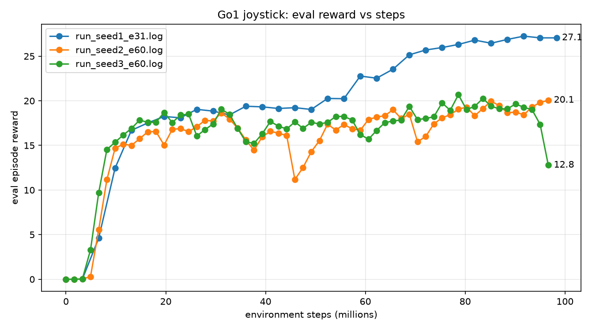

# Test Log 9.1 — Seed 1 at 31 evaluations, seeds 2 and 3 at 60 (flat ground, local RTX 5060)

**Date:** 2026-10-22
**Result:** Reward only, not rolled out yet. Seed 1 with 31 evaluations trained to 27.06 (the old seed 1 with 60 evaluations collapsed to 0.17). Seeds 2 and 3 with 60 evaluations did not collapse to zero, but neither climbed past about 21 (ending at 20.05 and 12.78). Every run with 60 evaluations missed the 26 to 27 level that the other runs reached.

**Purpose:** In [Test 9](../Test9/Test9.md) seed 1 collapsed, but it was also the only run with `num_evals` 60 (the others had 31), so I could not tell whether the seed or the schedule did it. This test changes one thing at a time: the same seed 1 with 31 evaluations, and two other seeds with 60.

## Setup

| Setting | seed 1 (e31) | seed 2 (e60) | seed 3 (e60) |
|---|---|---|---|
| Task | `Go1JoystickFlatTerrain` (default config) | same | same |
| `ppo_params.num_timesteps` | 96,000,000 | 96,000,000 | 96,000,000 |
| `ppo_params.num_evals` | **31** | **60** | **60** |
| `seed` (passed to `ppo.train`) | 1 | 2 | 3 |
| **Steps actually run** | **98,304,000** | **96,665,600** | **96,665,600** |
| Steps per epoch | 3,276,800 | 1,638,400 | 1,638,400 |
| `num_envs` | 4096 | 4096 | 4096 |
| Time (JIT + training) | 0:00:53 + 0:20:20 | 0:01:00 + 0:21:51 | 0:00:59 + 0:21:25 |
| Folder in WSL | `~/go1_seed1_e31` | `~/go1_seed2_e60` | `~/go1_seed3_e60` |

- Everything else was the same as in Test 9: `train_test.py` copied into a new folder, with the step count, evaluations and seed set by `sed` (no change to the repo script).
- The raw logs were 2.8 to 4.4 GB each because they kept the solver warnings. The logs in this folder keep only the progress and timing lines (the same filter as the Test 9 logs). The raw logs are still in WSL.
- At startup the first run printed several "Failed to allocate device memory" lines, then trained normally. I did not find the cause, so I treat them as a warning. (Test 8 did crash with an out-of-memory error, and I have not found that cause either.)

## Reward

<p align="center"></p>

| Run | Evaluations | Reward at the end | Shape |
|---|---|---|---|
| seed 1 (this test) | 31 | **27.06** (peak 27.25 at 91.75M) | about 17.5 to 19.4 from 16M to 49M, then climbs from about 52M |
| seed 2 (this test) | 60 | 20.05 | rises to 18.6 at 31M, then wobbles between 11 and 20, with a dip to 11.2 at 45.9M |
| seed 3 (this test) | 60 | 12.78 | about 15 to 21 until 93M, then 17.4 at 95M and 12.8 at the end |
| seed 1 (Test 9) | 60 | 0.17 | about 17 to 18.7 until 33M, drops to about 12 at 34M, then to 0.17 |

- The seed 1 run with 31 evaluations has the same shape as the walking runs in Tests 7 and 9: a plateau near 19, then a climb that starts around 52M and ends at 26 to 27. The reward reached 27.06 by 98.3M steps.
- Seeds 2 and 3 with 60 evaluations never leave the plateau. Both are noisier than the 31-evaluation runs, with several drops of 1.5 to 5 points. Seed 3 is falling at the end (19.0 at 93.4M, 17.4 at 95.0M, 12.8 at 96.7M), so it may be the start of a collapse, but the run ended there and I cannot say.
- A reward near 19 to 20 can mean a robot that stands still (the Test 7 run sat there until 57M and the old seed 1 stood still at the end, `track` 0.018). So these numbers say the 60-evaluation runs did not reach the walking-level reward. They do not say the robot did nothing.

## What this shows and what it does not

**Supported (by reward):**
- Seed 1 is not a broken seed. The same seed 1 trains fine at 31 evaluations.
- All three runs with 60 evaluations (seeds 1, 2, 3) stayed below 21 or collapsed. At other settings, seed 1 (e31) and seeds 2 to 5 (e31, [Test 9](../Test9/Test9.md)) reached 26 to 27 and the seed 0 run with 16 evaluations ([Test 7](../Test7/Test7.md)) reached 26.9.
- That points at the 60-evaluation schedule, not the seed, as the cause of the failure.

**Not shown:**
- No policy from this test has been rolled out. I do not know `track` for any of them. The seeds 2 to 5 runs from Test 9 are not rolled out either, so "5 of 5 reached 26 to 27" is a statement about reward curves.
- Changing `num_evals` also changes the random path, even with the same seed, so the comparison is "schedule, plus its side effects".
- Small counts: 3 runs at 60 against 6 runs at 16 or 31. That is a strong pattern but not a statistic.
- I have not tested other values (for example 45), so I do not know where the line is.

**A possible mechanism (my reading of Brax `train.py`, not tested):** each evaluation interval is split into `num_resets_per_eval` (10) chunks, and all environments are reset at the start of each chunk. With 4096 environments that means a reset every 200 steps at 16 evaluations, 80 steps at 31 and 40 steps (0.8 s of simulated time) at 60. An episode is 1000 steps, so none of these ever sees a full episode, and the 60-evaluation runs see the shortest pieces. That might change what the robot learns, but I have not shown it.

## Next

1. Roll out `go1_final` of all three runs on 1 / 0 / 0 (`--no-video`, about 2 minutes each): do they walk? Paste below.
2. If the 31-evaluation run walks, roll out its checkpoints from 45M to 70M and compare the onset with the Test 7 run (stands at 57.3M, walks at 65.5M).
3. Roll out `go1_final` of seeds 2 to 5 from [Test 9](../Test9/Test9.md) too.
4. A seed 4 or 5 at 60 evaluations would be a third sample for the 60-evaluation side, and an intermediate value (45) would show where the line is.
5. Write the Test 9 and Test 9.1 results into one short table for the findings.

```bash
source ~/go1env/bin/activate
for d in go1_seed1_e31 go1_seed2_e60 go1_seed3_e60; do
  cd ~/$d && echo "== $d" && python /mnt/c/Users/Admin/Documents/HaiDuong/Scripts/rollout.py 1 0 0 --no-video 2>&1 | grep -vE "solver iterations|To disable" | tee rollout_1_0_0.txt
done
```

## Evidence

- Overlay: [reward_plot_all.png](./reward_plot_all.png)
- Seed 1 (31 evaluations): [log](./seed1_e31/run_seed1_e31.log), [graph](./seed1_e31/reward_plot.png)
- Seed 2 (60 evaluations): [log](./seed2_e60/run_seed2_e60.log), [graph](./seed2_e60/reward_plot.png)
- Seed 3 (60 evaluations): [log](./seed3_e60/run_seed3_e60.log), [graph](./seed3_e60/reward_plot.png)
- Earlier runs: [Test 9](../Test9/Test9.md) (seeds 1 to 5, the old seed 1 with 60 evaluations is in `seed1/`)
- Checkpoints and raw logs: WSL `~/go1_seed1_e31`, `~/go1_seed2_e60`, `~/go1_seed3_e60`, not copied here
